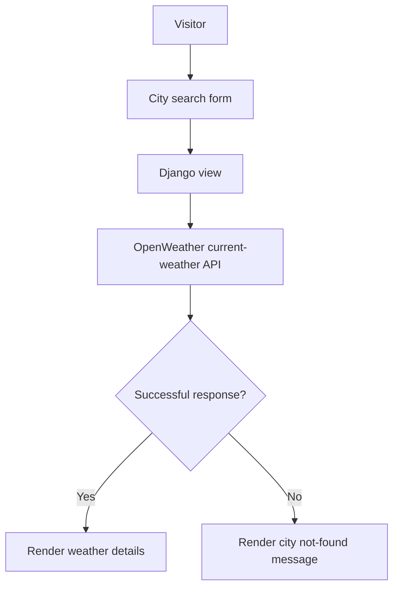

<!-- Documentation-only refresh: README.md. -->

<div align="center">

  

  <p><strong>A Django web application for looking up current weather conditions in cities across Cameroon.</strong></p>

  <p>
    <a href="https://cameroon-weather-app.onrender.com/"></a>
    <a href="https://github.com/dieudonne670/cameroon-weather-app"></a>
  </p>

  <p>
    
    
    
    
    
  </p>

</div>

---

## 🌦️ Overview

**Cameroon Weather App** is a Django web application that lets visitors search for a city in Cameroon and retrieve its current weather conditions through the OpenWeather API.

The application sends a city query to OpenWeather, requests metric units, and displays selected weather information when the API returns a successful response.

**Live demo:** [cameroon-weather-app.onrender.com](https://cameroon-weather-app.onrender.com/)

## ✨ Features

The current Django view implements:

- Search for a city in Cameroon.
- Retrieve current weather data from OpenWeather.
- Display temperature in metric units.
- Display a weather description and provider icon.
- Display humidity.
- Display wind speed.
- Show a not-found message when the API does not return a successful result.

The application is intentionally focused on a simple weather lookup workflow. Forecasts, saved locations, severe-weather alerts and historical weather are not claimed as existing features.

## 🔄 How it works



The application requests the OpenWeather current-weather endpoint with the selected city, the Cameroon country code and metric units. The Django view extracts temperature, description, icon, humidity and wind speed from a successful response.

## 🧰 Technology stack

| Technology | Purpose |
| --- | --- |
| Python | Backend language |
| Django 6.0.3 | Web framework |
| OpenWeather API | Current weather data |
| Requests | HTTP requests to the weather API |
| HTML and CSS | Page structure and styling |
| Bootstrap | UI framework documented by the project |
| SQLite | Default Django database configuration |
| Gunicorn | WSGI application server |
| Render | Hosted deployment |

## 🗂️ Project structure

The repository's documented layout is:

```text
cameroon-weather-app/
├── the_weather/
│   ├── the_weather/
│   │   ├── settings.py
│   │   └── urls.py
│   ├── weather/
│   │   ├── views.py
│   │   ├── urls.py
│   │   ├── templates/
│   │   └── static/
│   └── manage.py
├── requirements.txt
└── README.md
```

## ⚙️ Run locally

### Prerequisites

- Python compatible with Django 6.0.3
- pip
- An OpenWeather API key

### 1. Clone the repository

```bash
git clone https://github.com/dieudonne670/cameroon-weather-app.git
cd cameroon-weather-app
```

### 2. Enter the Django project directory

```bash
cd the_weather
```

### 3. Create and activate a virtual environment

Linux / macOS:

```bash
python3 -m venv venv
source venv/bin/activate
```

Windows PowerShell:

```powershell
python -m venv venv
venv\Scripts\Activate.ps1
```

### 4. Install dependencies

```bash
pip install -r requirements.txt
```

If your checkout places `requirements.txt` in the repository root, run the installation command from that root instead.

### 5. Configure the OpenWeather API key

The Django settings read the API key from the `OPENWEATHER_API_KEY` environment variable.

Linux / macOS:

```bash
export OPENWEATHER_API_KEY="your_openweather_api_key"
```

Windows PowerShell:

```powershell
$env:OPENWEATHER_API_KEY="your_openweather_api_key"
```

Do not commit API keys or other credentials to Git.

### 6. Apply migrations and start Django

```bash
python manage.py migrate
python manage.py runserver
```

Open [http://127.0.0.1:8000/](http://127.0.0.1:8000/) in your browser.

## ☁️ Deployment

The project is hosted on Render:

[https://cameroon-weather-app.onrender.com/](https://cameroon-weather-app.onrender.com/)

The repository's documented Gunicorn start command is:

```bash
gunicorn the_weather.wsgi
```

Configure the required `OPENWEATHER_API_KEY` environment variable in the hosting environment.

### Production configuration note

The currently inspected `the_weather/settings.py` reads `OPENWEATHER_API_KEY` from the environment, but it also contains a hardcoded Django `SECRET_KEY` and sets `DEBUG=True`. Before using this code as a production deployment baseline:

- Rotate the Django secret key if it has been used in a public environment.
- Load `SECRET_KEY` from a secure environment variable.
- Set `DEBUG=False` in production.
- Keep `ALLOWED_HOSTS` restricted to the intended domains.
- Avoid returning or logging raw third-party API responses in production.
- Add timeouts and safe handling for OpenWeather network errors and invalid responses.

The presence of a live demo does not by itself establish that every production security control has been applied.

## 🔐 API key and error handling

The weather API key is read from Django settings, which obtain it from the `OPENWEATHER_API_KEY` environment variable.

The current view handles a non-successful API response by displaying a city-not-found message. A stronger production implementation should also distinguish invalid API keys, rate limits, provider outages, malformed responses and network timeouts.

## 🛣️ Possible next improvements

- [ ] Add a request timeout and robust exception handling.
- [ ] Validate and normalize city input.
- [ ] Improve error messages for API outages and rate limits.
- [ ] Add automated tests for successful and unsuccessful API responses.
- [ ] Improve accessibility and responsive UI behavior.
- [ ] Add multi-day forecasts if supported by the chosen API plan.
- [ ] Add weather alerts and saved locations.
- [ ] Add caching to reduce repeated external API requests.

## 👨‍💻 Author

**Kindong Dieudonne**  
Software Engineering graduate · Python Backend Developer

- GitHub: [@dieudonne670](https://github.com/dieudonne670)
- LinkedIn: [Kindong Dieudonne](https://www.linkedin.com/in/kindong-dieudonne-826ba9328/)

---

<div align="center">
  <p><strong>Weather information, made easier to access across Cameroon.</strong></p>
</div>
